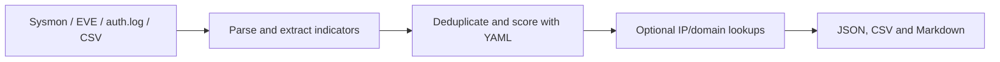

# SOC Triage Toolkit

An offline-first Python CLI that turns Sysmon, Suricata EVE, Linux authentication and CSV records into prioritized SOC triage reports. It extracts indicators, deduplicates identical records, assigns configurable risk scores and ATT&CK tags, and optionally looks up public IPs and domains.



## Quick start

With Python 3.11 or newer:

```sh
python -m pip install -e ".[test]"
soc-triage --auth-year 2025 --input sysmon samples/sysmon.jsonl --input sysmon samples/sysmon-export.json --input suricata samples/eve.jsonl --input auth samples/auth.log --input csv samples/events.csv --output output
python -m pytest
```

Use `--risk-config` with a copy of [risk.yml](src/soc_triage/risk.yml) to adjust points and tags. Rules use exact field matches combined with AND. Matching points sum to a maximum of 100. For live enrichment, set provider keys in the process environment as listed in [.env.example](.env.example), then add `--enrich`. The CLI uses VirusTotal for IPs and domains and AbuseIPDB for IPs. Docker usage:

```sh
docker build -t soc-triage-toolkit .
docker run --rm --mount "type=bind,source=$PWD/samples,target=/samples,readonly" soc-triage-toolkit --input suricata /samples/eve.jsonl --output /tmp/report
```

Mount a writable output directory and point `--output` to it to keep the Docker reports. The image runs as UID 10001, so grant that UID write access on Linux.

## Repository structure

| Path | Contents |
| --- | --- |
| `src/soc_triage/` | CLI, parsers, indicators, enrichment, risk rules and writers |
| `samples/` | Sanitized synthetic fixtures covering the four input formats |
| `tests/` | CLI, parser, scoring and mocked API regression tests |
| `docs/verification.txt` | Local validation transcript |

## Verification

See [the local transcript](docs/verification.txt) for pytest, the installed CLI run and container checks. [The run checklist](NEEDS_USER_RUN.md) tracks a live provider smoke test.

## Results

The sample CLI run is recorded in [the transcript](docs/verification.txt).

```text
Read 7 records; wrote 6 unique records and 8 indicators.
Reports: output\alerts.json, output\alerts.csv, output\incident.md
```

Live threat-intelligence API results — TODO(user): fill after running.

## Limitations

- JSON inputs accept JSON Lines, one event object, or an array. Sysmon supports nested Winlogbeat-style records and Windows Event XML converted to JSON, including named `EventData.Data`. Export raw EVTX into a supported JSON shape before use.
- Traditional syslog timestamps retain local wall time. Use `--auth-year` for archived logs and split logs that span calendar years. CSV accepts a header row and optional `timestamp`, `host`, `event_code`, `action` and `message` columns.
- Deduplication matches full normalized record content. Scoring gives triage priority and tags candidate behaviors. Indicators extracted from free text can be noisy.
- Lookups send public IPs and domains to providers only when explicitly enabled. URL query strings and fragments are removed from URL indicators. JSON and CSV reports can still include sensitive original messages. Enrichment has no persistent cache and records provider errors in the report.

## MITRE ATT&CK mapping

| Technique | Default signal | Interpretation |
| --- | --- | --- |
| [T1110.001 Password Guessing](https://attack.mitre.org/techniques/T1110/001/) | SSH authentication failure | A single failure calls for context. |
| [T1003.001 LSASS Memory](https://attack.mitre.org/techniques/T1003/001/) | Sysmon process access to an LSASS image | Inspect caller, access rights and adjacent evidence. |
